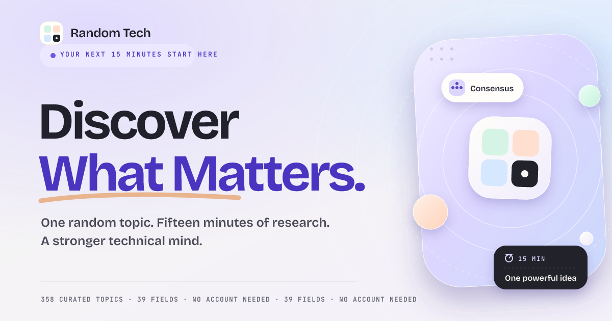

# Random Tech

**Discover What Matters.** One random topic. Fifteen minutes of research. A stronger
technical mind.

Random Tech is a curated technical discovery platform for computer science students. It is
not a content feed and not an AI wrapper: pressing **Generate a Topic** instantly draws one
reviewed question from a local library of **358 topics across 39 fields**, built for
fifteen minutes of independent research.



## What is implemented

- **The Draw** — an instant, category-balanced random generator with optional field,
  collection, and difficulty tuning. It avoids recently seen topics, remembers a 20-topic
  history, animates card reveals, and never waits on a network request.
- **Curated library** — 358 topics across the 39 required taxonomy areas, each with a
  category, sub-field, difficulty, summary, why-it-matters explanation, research question,
  tags, and AI-era classification. Data is generated from reviewed authoring files, not
  invented at runtime.
- **Explore** — full-text search across titles, tags, summaries, and fields; category,
  difficulty, and AI-era filters; sorting; 24-at-a-time loading; and a topic detail dialog
  with prerequisites (`Helpful background`), tags, copy/save actions, and related topics
  scored by real category and tag overlap.
- **Saved shelf** — bookmark topics without an account. Saved IDs and reflections live in
  `localStorage`, degrade to in-memory storage when unavailable, and notify the user when
  persistence is not possible.
- **The 15-minute ritual** — focused research mode with an optional start/pause/resume/reset
  timer, five-step checklist with persisted progress, session completion, reflection
  prompts, and a saved note.
- **Library standard** — a dedicated page documenting the ten editorial rules, what the
  library excludes, and why the shipped count is 358 rather than a fabricated 10,000.
- **Design system** — a claymorphic visual language built from layered shadows, inset
  highlights, pillowy surfaces, pastel tint families, tactile pressed states, custom SVG
  clay illustration, and a hand-built dark theme. No UI framework, no glassmorphism.
- **Accessibility** — semantic landmarks, one `h1` per page, labelled controls, visible focus
  states, keyboard and focus-trapped dialogs, live regions for copy/toast/topic feedback,
  `prefers-reduced-motion`, `prefers-contrast`, and color-independent status cues.
- **Performance & SEO** — route-level code splitting, a separately cached data chunk,
  self-hosted fonts (no third-party font requests), memoized filtering, deferred search,
  dynamic page titles/descriptions, canonical links, Open Graph/Twitter cards, structured
  data, favicon, and a rendered 1200×630 social image.

## Stack

React 19 · TypeScript · Vite 7 · React Router 7 · hand-authored CSS design tokens.
Vitest covers dataset integrity, search/filter behavior, draw fairness, and related-topic
scoring. No backend is required for this version.

## Run it

```bash
npm install
npm run dev        # http://localhost:5173
npm run build      # library check + typecheck + production build
npm run preview    # serve dist/
npm run test       # vitest
npm run library:check
npm run social:build   # re-render the social card after a content batch
```

For a production host, configure an SPA fallback that serves `index.html` for unknown
paths (`/explore`, `/research/:id`, `/saved`) so deep links resolve.

## Architecture

```
content/                 source of truth for the topic library
  categories.json        taxonomy, color family, icon, helpful background
  topics/*.txt           pipe-delimited topic records, one field per file
  fonts/                 subset OFL fonts used by the social-image renderer
scripts/
  build-library.mjs      validation + deduplication + dataset/count generation
  build-social-image.py  renders public/og-image.png + app icons from live counts
src/
  data/library.json      generated runtime dataset (do not hand-edit)
  lib/library.ts         single data-access seam: topics, categories, search, related
  lib/selection.ts       draw engine: collection filters, balanced category sampling
  lib/storage.ts         guarded localStorage with in-memory fallback
  lib/clipboard.ts       secure-context clipboard with legacy fallback
  lib/meta.ts            per-route title, description, canonical
  providers/             theme, toasts, saved topics + reflections
  components/            layout, navigation, topic cards, dialog, icons, controls
  pages/                 Discover, Explore, Saved, Research, 404
  styles/                tokens, components, pages, library, responsive, motion
```

### Topic model

```ts
interface Topic {
  id: string;                 // stable slug derived from category + title
  title: string;              // canonical researchable question
  category: string;
  categorySlug: string;
  subcategories: string[];    // focus area inside the field
  difficulty: 'Beginner' | 'Intermediate' | 'Advanced';
  estimatedMinutes: number;   // 15
  evergreen: boolean;
  aiRelevance: boolean;       // AI-era relevance, used by filters
  emerging: boolean;
  summary: string;
  whyItMatters: string;
  researchQuestion: string;
  tags: string[];
}
```

### Draw fairness

Each draw groups eligible topics by field, picks a field uniformly at random, then picks a
topic within it. Large fields therefore cannot crowd out small ones. Recently seen topics
are excluded until the eligible pool would otherwise be empty. The engine is a pure
function and is covered by tests that assert collection, difficulty, and coverage behavior.

### Library scale

The runtime dataset is a bundled JSON module at this size (281 kB minified / 71 kB gzip).
The content pipeline is described in [`content/README.md`](content/README.md), including the
honest dataset count and the path to 10,000 validated topics. When the library outgrows the
bundle, only `src/lib/library.ts` must change: it is the data seam consumed by every page.

## Design notes

- **Palette.** Warm off-white `#F7F6F2`, lavender `#DCD6FF`, pale blue `#D5E8FF`, mint
  `#D5F4E5`, peach `#FFE0D0`, ink `#20212B`, muted `#666775`, accent `#6C58E3` (darkened
  from the reference `#7765E8` so that white button text clears 4.5:1 contrast). Five
  tint families map the taxonomy to color without using every accent at once.
- **Clay.** Raised surfaces combine an inner top highlight, a soft inner bottom shade, a
  long ambient shadow, and a tight contact shadow. Buttons use a modeled bottom edge and
  compress into their surface on `:active`. Dark mode gets hand-tuned surfaces rather than
  inverted colors.
- **Motion.** Short transitions on press, hover, reveal, copy, save, filters, and the timer.
  Ambient illustration motion is slow and disabled under `prefers-reduced-motion`.

## Known limits

- The library is 358 topics, not 10,000. The UI reports the real number everywhere.
- Saved topics and notes are per-browser; there is no account system yet.
- All topics are scoped to 15 minutes, so a separate time filter is intentionally omitted.
- Automated browser screenshots were not available in the build sandbox; visual checks were
  done against markup/CSS invariants, and a real-browser pass is recommended before launch.
